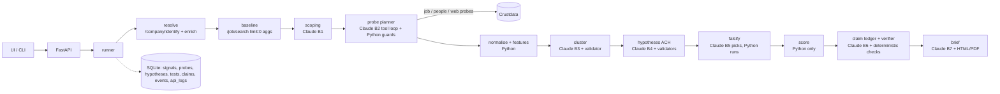

# CoreData

Competitor intelligence from weak public signals. Give it a competitor (and optionally a question like
*"Are they moving into robotics?"*). It collects company, hiring, people and web signals from **Crustdata**,
links them into clusters, and produces **evidence-backed, falsification-tested hypotheses** in a sourced brief.

Claude (`claude-opus-5-5`) is the reasoning layer, used in **7 bounded places**. Crustdata is the data
layer. Python owns every number, score and evidence label.

## Architecture



| Where Claude is used | Guardrail |
|---|---|
| Scoping themes (B1) | ≤5 themes, ≥1 data-driven, no generic phrases |
| Probe planner (B2), the only agent loop | no duplicate calls, counts before rows, budget/MAX_PROBES caps, deterministic fallback plan |
| Clustering (B3) | unknown ids dropped, ≤1 cluster per signal, weak clusters never promoted |
| Hypotheses (B4) | ids must exist, numbers must appear in the input, banned certainty phrases, safe wording, full H1/H2/H3 matrix; 2 repairs, then a templated fallback |
| Test selection (B5) | unknown tests dropped; novelty/evergreen/scale/peer always run |
| Verifier (B6) | unsupported facts relabelled "unverified" |
| Brief writer (B7) | may only cite ledger claim ids; unverified only in Unknowns |

## Quick start (no commands)

**Web UI (Windows):** double-click `CoreData-Web.bat`. It starts the server and opens http://localhost:8000. Close the window to stop it.

**Guided terminal wizard:** on Windows, double-click `CoreData.bat`. On Mac/Linux, run `./coredata.sh`.

On first run, the launcher creates the Python environment and installs everything. It then asks a few plain questions:
1. **Your API keys**: an Anthropic key (`sk-ant-…`) and a Crustdata key. Keys already in `.env` are reused. A Gemini or OpenAI key is caught and you're asked again. You can optionally save the keys to `.env`.
2. **The competitor**: a website or company name. If the name matches several companies, you pick one from a list.
3. **Your question**: type one, pick a numbered example, or press Enter for a data-driven scan.
4. **Peer companies** to compare against (optional).

It then shows live progress (Claude's decisions and each Crustdata call), prints the hypotheses, saves the brief to `exports/`, and opens it in your browser.

## Setup (manual)

```bash
python -m venv .venv
```
```bash
.venv/Scripts/python -m pip install -r requirements.txt
```
Copy `.env.example` to `.env` and fill in `CRUSTDATA_API_KEY` and `ANTHROPIC_API_KEY`.

1. **Hour 1: discover your account's real API shapes** (writes `docs/crustdata_findings.md`, records fixtures):
   ```bash
   .venv/Scripts/python -m scripts.discover example.com --theme "robotics" --record
   ```
2. **Build the UI once** (React + Vite + Recharts in `frontend/`; needs Node 18+):
   ```bash
   cd frontend && npm install && npm run build
   ```
3. **Run the app** at http://localhost:8000. FastAPI serves `frontend/dist`, or a basic fallback page if you haven't built the UI:
   ```bash
   .venv/Scripts/python -m uvicorn app.main:app --app-dir backend --port 8000
   ```
   The UI asks for Anthropic and Crustdata API keys when starting an investigation (leave them blank to use the
   keys from `.env`). Keys are used for that run and are not stored in SQLite or browser storage. For deployments,
   serve the UI over HTTPS.
   For UI development with hot reload, keep the backend running and use `cd frontend && npm run dev`, then open http://localhost:5173 (API calls are proxied to :8000).
4. **Or run from the CLI:**
   ```bash
   .venv/Scripts/python -m scripts.run_investigation --domain example.com --question "Are they moving into robotics?" --competitors peer1.com,peer2.com --html brief.html
   ```
5. **Tests** (fake Crustdata and scripted LLM; no keys or credits needed):
   ```bash
   cd backend && ../.venv/Scripts/python -m pytest -q
   ```

### Modes and switches (`.env`)
- `PROVIDER_MODE=replay` serves recorded real responses from `fixtures/` (run once with `RECORD=1`). The UI and report show a REPLAY banner.
- `FAIL_ENDPOINT=/job/search` and `FAIL_LLM=1` are chaos switches. The run still produces a labelled report.
- `ENABLE_PEOPLE`, `ENABLE_WEB`, `CREDIT_BUDGET`, `MAX_API_CALLS`, `MAX_PROBES`.

## API (PRD 8.3)
`POST /api/investigations` · `GET /api/investigations/{id}` · `POST …/run` · `POST …/confirm_company` ·
`GET …/signals` · `GET …/hypotheses` · `GET …/report` · `GET …/export` · `GET …/brief` · `GET …/events` (SSE) ·
`GET …/api_logs` · `POST/GET …/watchlist`

## Limitations
- Job postings can be stale, closed, evergreen or duplicated. The evergreen test and the dedupe step reduce this but cannot remove it.
- Crustdata data is provider-normalised. Profile fields can lag.
- The credit cost of `limit:0` aggregations is unverified (counted as 0 and flagged). Check your dashboard.
- Hypotheses are interpretations of public signals, **not predictions**. Evidence strength is rule-based (Low/Medium/High), never a probability.
- No fabricated or seeded data: replay mode uses only recorded real responses.
